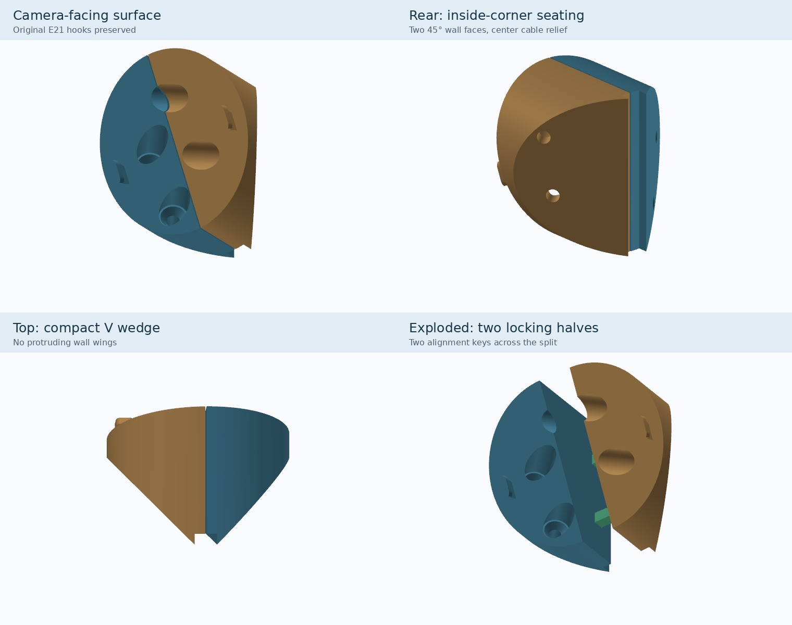

# Eufy E21 compact 90° corner wedge — V10

A **static, low-wing-profile corner wedge** for an **inside 90° wall corner**, created from the original Eufy E21 retaining-hook geometry. This is a **fit-test prototype** and has **not** been physically tested for strength or secure locking.

## Downloads

- [**Print-ready STL — both halves and two alignment keys**](E21_Corner_Wedge_V10_PRINT_ALL.stl)
- [**Complete source and STL package**](E21_Corner_Wedge_V10_Package.zip)
- [**Editable OpenSCAD source**](E21_Corner_Wedge_V10.scad)

## Design

- Circular E21-facing surface; hook geometry retained from the original slanted mount.
- V-shaped rear surfaces contact both sides of a 90° inside corner. No wide wall wings.
- Camera points out along the corner bisector, with **fixed 25° tilt**.
- **Four wall-normal countersunk screw channels** (two per wall), designed for small flat-head screws; check your actual hardware before use.
- **Two mechanically keyed printed halves**, one original retaining hook per half, independently attached to the walls. Keys aid alignment; they do not alone lock the halves against pulling apart.
- **7 mm wide rear cable channel** along the corner.
- Face is approximately **57.3 mm wide**. Maximum projection into the room is approximately **47.2 mm** at the deep end due to the fixed tilt.

## Printing

Import `E21_Corner_Wedge_V10_PRINT_ALL.stl` into Bambu Studio. Both halves are already oriented **on their split faces** for hook strength. Suggested trial settings: PETG, 0.16 mm layers, six walls, 35–40% gyroid infill, and a 6–8 mm brim. Preview supports carefully and keep them off the retaining hooks.

**Verify the push-and-slide E21 locking action, key fit, screw seating, and real corner angle before installation. Do not install where the camera could fall onto a crib.** Keep the power cord out of children's reach. The model has passed mesh-watertight checks but no physical load test.

The ZIP includes individual STLs, the original base meshes, the full master wedge STL, and a rebuild script. The standalone .scad needs those meshes extracted beside it to render.
